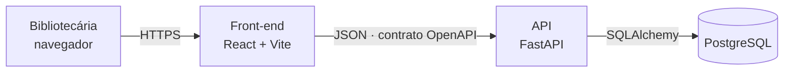
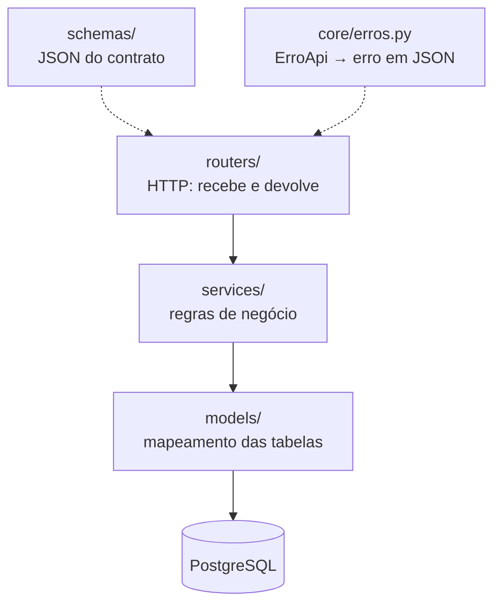
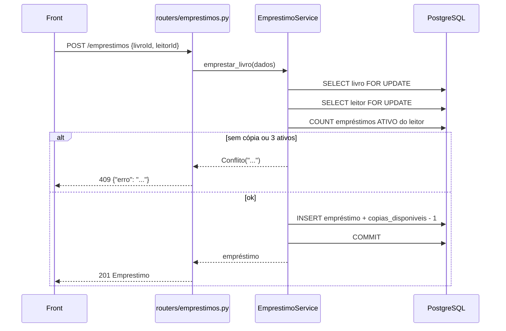

# Arquitetura

Visão de como o sistema da Biblioteca Comunitária está organizado, por que foi organizado assim
e como uma requisição percorre as camadas.

## Visão geral

| Parte | Pasta | Tecnologia | Documentação |
|---|---|---|---|
| Front-end | `web/` | React 19, Vite, React Router, react-hook-form + zod | [web/README.md](../web/README.md) |
| API | `api/` | Python 3.12, FastAPI, SQLAlchemy 2, Pydantic 2 | [api/README.md](../api/README.md) |
| Banco | `database/` | PostgreSQL (tipos, CHECKs, trigger, view) | [database/README.md](../database/README.md) · [BANCO.md](BANCO.md) |
| Contrato | `openapi-biblioteca.yaml` | OpenAPI 3.1 | [API.md](API.md) |

É um **monolito modular**: uma API, um banco e um front, cada um com responsabilidades claras.
Não há filas, cache nem microsserviços porque não há requisito de escala: é uma biblioteca de
bairro. A organização em camadas permite evoluir depois sem reescrever as regras.

## Como o time trabalhou: contrato primeiro

O contrato `openapi-biblioteca.yaml` foi escrito **antes do código** (contract-first). Ele é a
fonte da verdade entre front e back:

- o front implementou as telas contra o contrato (com `VITE_MOCK=true` enquanto a API não existia);
- a API implementou as mesmas rotas e nomes; `api/tests/test_contrato.py` falha se algo sair do contrato;
- o banco foi desenhado em paralelo, e as diferenças de nome ficaram isoladas em `api/app/models/`.

Assim front, back e banco andaram em paralelo e a integração não quebrou.

## Camadas da API

| Camada | Responsabilidade | Não faz |
|---|---|---|
| `routers/` | Declara as rotas do contrato, lê parâmetros e chama o service | Regra de negócio |
| `services/` | Regras: validações, limite de 3, cópias, filtros, ranking | Conhecer HTTP |
| `models/` | Mapeia tabelas e colunas do banco (único lugar com nomes do SQL) | Regras |
| `schemas/` | Formato do JSON (camelCase), igual ao contrato | Acesso ao banco |
| `core/` | Configuração, sessão do banco e tradução de erros para `{"erro": "..."}` | — |

Regra de dependência: `router → service → model → banco`, nunca ao contrário. Os services lançam
exceções de negócio (`RequisicaoInvalida`, `NaoEncontrado`, `Conflito`) e é a borda HTTP
(`core/erros.py`) que as transforma em 400/404/409.

### Exemplo: emprestar um livro

## Decisões de arquitetura

| Decisão | Por quê | Custo aceito |
|---|---|---|
| Monolito modular (uma API) | Time pequeno, escala pequena, um deploy só | Se crescer muito, separar módulos depois |
| Contrato OpenAPI antes do código | Front e back em paralelo, sem quebra na integração | Mudar um nome exige combinar e atualizar o contrato |
| PostgreSQL (relacional) | Dados com relacionamentos; transação para não errar o estoque | — |
| Consistência acima de disponibilidade | Estoque e limite de 3 não podem errar | Pedidos simultâneos no mesmo livro/leitor esperam um pelo outro |
| `SELECT ... FOR UPDATE` no empréstimo e na devolução | Dois pedidos ao mesmo tempo não levam a última cópia nem passam do limite | Travas curtas na linha do livro e do leitor |
| Regras na API **e** no banco (CHECK + trigger) | A API dá a mensagem certa; o banco é a rede de segurança | Regra escrita em dois lugares |
| Ranking e relatório como consultas, sem tabela extra | Sempre corretos, sem dado duplicado | Cálculo a cada pedido (barato neste volume) |
| Uma consulta para relatório e CSV (`_consultar_emprestimos`) | O CSV exporta exatamente o que a tela mostra | — |
| Situação do relatório decidida por `data_devolucao` | Uma fonte da verdade; o banco garante que bate com `status` | — |
| Sem cache | Consultas baratas no volume de uma biblioteca de bairro | Reavaliar se a latência ficar perto do limite |
| Sem login no MVP | As histórias não pedem autenticação | Qualquer pessoa com o link usa o sistema |

## Concorrência e consistência

- **Última cópia:** o livro é lido com `FOR UPDATE`; o segundo pedido espera o primeiro terminar
  e então vê `copias_disponiveis = 0` → 409.
- **Limite de 3:** o leitor é travado com `FOR UPDATE` antes da contagem de ativos; no banco,
  o trigger `regras_emprestimo` confere de novo.
- **Devolução duplicada:** devolver um empréstimo já devolvido responde 409 e não soma cópia.
- **Estoque nunca negativo:** `CHECK (copias_disponiveis >= 0)` no banco.
- **Status coerente:** `CHECK status_coerente` exige ATIVO sem data de devolução e DEVOLVIDO com data.

## Testes

56 testes automatizados em `api/tests/` (pytest), um arquivo por história, mais o teste do
contrato. Eles rodam num SQLite em memória criado a partir dos models, zerado a cada teste.
Veja [api/README.md](../api/README.md#testes).
