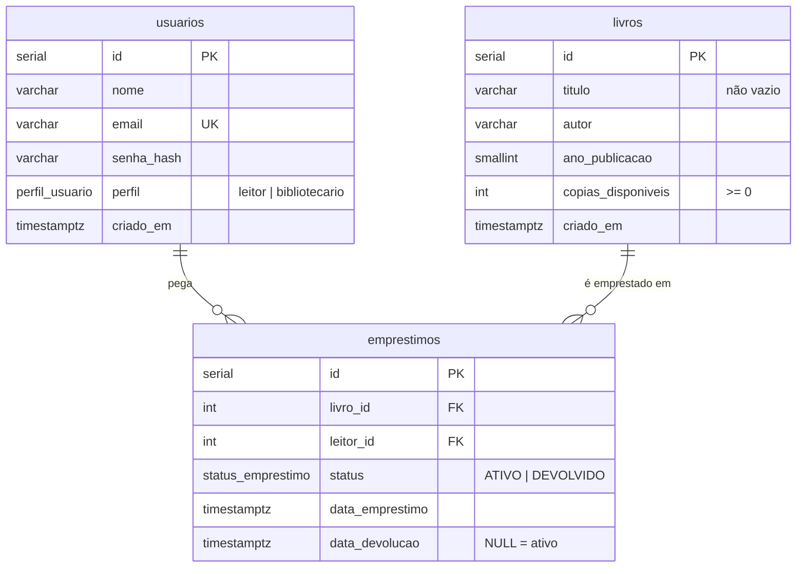

# Banco de dados (schema)

PostgreSQL. Script completo em [`database/banco_biblioteca.sql`](../database/banco_biblioteca.sql).
Como aplicar: [database/README.md](../database/README.md).

## Diagrama

## Tipos

| Tipo | Valores |
|---|---|
| `perfil_usuario` | `leitor`, `bibliotecario` |
| `status_emprestimo` | `ATIVO`, `DEVOLVIDO` |

## Tabelas

### `usuarios` (BIBL-2, BIBL-4)
| Coluna | Tipo | Regra |
|---|---|---|
| `id` | `SERIAL` | PK |
| `nome` | `VARCHAR(120)` | obrigatório |
| `email` | `VARCHAR(160)` | obrigatório, **único** |
| `senha_hash` | `VARCHAR(100)` | obrigatório (bcrypt; a API atual não usa, não há login) |
| `perfil` | `perfil_usuario` | padrão `leitor` |
| `criado_em` | `TIMESTAMPTZ` | padrão `now()` |

Guarda leitores e bibliotecários. Para a API, **leitor é o usuário com `perfil = leitor`**.

### `livros` (BIBL-1, BIBL-2, BIBL-3)
| Coluna | Tipo | Regra |
|---|---|---|
| `id` | `SERIAL` | PK |
| `titulo` | `VARCHAR(200)` | obrigatório, `CHECK (btrim(titulo) <> '')` |
| `autor` | `VARCHAR(150)` | obrigatório |
| `ano_publicacao` | `SMALLINT` | obrigatório ("não pode ser no futuro" é validado na API) |
| `copias_disponiveis` | `INT` | obrigatório, `CHECK (copias_disponiveis >= 0)` |
| `criado_em` | `TIMESTAMPTZ` | padrão `now()` |

### `emprestimos` (BIBL-2 a BIBL-5)
| Coluna | Tipo | Regra |
|---|---|---|
| `id` | `SERIAL` | PK |
| `livro_id` | `INT` | FK → `livros(id)` |
| `leitor_id` | `INT` | FK → `usuarios(id)` |
| `status` | `status_emprestimo` | padrão `ATIVO` |
| `data_emprestimo` | `TIMESTAMPTZ` | padrão `now()` |
| `data_devolucao` | `TIMESTAMPTZ` | `NULL` enquanto ativo |

`CONSTRAINT status_coerente`: `ATIVO` sem `data_devolucao`, `DEVOLVIDO` com `data_devolucao`.
Por isso status e data mudam sempre juntos. As FKs não têm `ON DELETE CASCADE`: o histórico de
empréstimos nunca é apagado junto com um livro ou usuário.

## Índices

| Índice | Colunas | Para quê |
|---|---|---|
| `idx_emprestimos_leitor_status` | `(leitor_id, status)` | contar os ativos do leitor (limite de 3) |
| `idx_emprestimos_livro` | `(livro_id)` | ranking |
| `idx_emprestimos_data` | `(data_emprestimo)` | filtro por período do relatório |

## View `relatorio_emprestimos` (BIBL-4, BIBL-5)

Junta empréstimo, livro e leitor: `id`, `livro` (título), `leitor` (nome), `leitor_id`,
`data_emprestimo`, `data_devolucao`, `situacao`. Não expõe e-mail nem senha.
A API monta a mesma consulta pelo SQLAlchemy; a view serve para consultas diretas no banco.

## Trigger `regras_emprestimo`

`BEFORE INSERT OR UPDATE OF leitor_id, status ON emprestimos`, função `verificar_regras_emprestimo()`.
Só vale para empréstimos `ATIVO` (gravar histórico `DEVOLVIDO` passa direto):

1. só usuário com perfil `leitor` pode pegar livro;
2. no máximo **3 empréstimos ativos** por leitor.

Usa `FOR UPDATE` no usuário, então dois empréstimos simultâneos do mesmo leitor esperam um pelo
outro. É a rede de segurança: a API confere antes para devolver a mensagem certa.

## Onde cada regra é garantida

| Regra | API (mensagem ao usuário) | Banco (garantia) |
|---|---|---|
| Título não vazio | `livro_service` → 400 | `CHECK btrim(titulo) <> ''` |
| Ano não no futuro | `livro_service` → 400 | — |
| Cópias não negativas | `livro_service` → 400 | `CHECK copias_disponiveis >= 0` |
| Sem cópia não empresta | `emprestimo_service` → 409 | `CHECK copias_disponiveis >= 0` |
| Máximo 3 ativos | `emprestimo_service` → 409 | trigger `regras_emprestimo` |
| Só leitor pega livro | `emprestimo_service` → 404 | trigger `regras_emprestimo` |
| Status e data coerentes | `emprestimo_service` muda os dois juntos | `CHECK status_coerente` |

## Nomes no banco × nomes na API

O código usa os nomes do contrato. A tradução fica só em `api/app/models/`:

| API / contrato | Banco |
|---|---|
| `Leitor` | tabela `usuarios` com `perfil = leitor` |
| `ano` | `livros.ano_publicacao` |
| `situacao` (`ativo` / `devolvido`) | `emprestimos.status` (`ATIVO` / `DEVOLVIDO`) |

## Dados de exemplo (seed)

| Usuário | Perfil | Situação |
|---|---|---|
| Ana Bibliotecária | bibliotecario | não pode pegar livros |
| Bruno Leitor | leitor | 1 empréstimo já devolvido (histórico) |
| Carla Leitora | leitor | 3 empréstimos ativos (testa o limite) |

Livros: Dom Casmurro, O Pequeno Príncipe, **Capitães da Areia (0 cópias, testa "sem cópia")**,
Vidas Secas e A Hora da Estrela.
