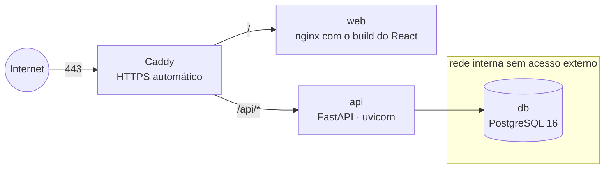

# Deploy

Duas formas documentadas: numa VPS com Docker Compose (como está publicado) e no Dokploy.

**Produção atual:** https://biblioteca-comunitaria.duckdns.org
(front em `/`, API em `/api`, Swagger em `/api/docs`).

## Opção 1: VPS com Docker Compose + Caddy (publicação atual)



| Serviço | Imagem | Detalhes |
|---|---|---|
| `db` | `postgres:16-alpine` | Volume `pgdata`; na primeira subida roda `database/banco_biblioteca.sql`; rede interna, **sem porta exposta** |
| `api` | build de `api/Dockerfile` | `CRIAR_TABELAS=false`, `--root-path /api`; contêiner somente leitura, sem privilégios |
| `web` | build multi-stage (Node → nginx sem root) | `VITE_API_URL=https://<domínio>/api` gravado no build; fallback para `index.html` (React Router) |
| Caddy | `caddy:2-alpine` | Certificado Let's Encrypt; `handle_path /api/*` → api, resto → web |

### Arquivos usados na VPS (fora do repositório)

`docker-compose.yml` (resumo):
```yaml
services:
  db:
    image: postgres:16-alpine
    environment:
      POSTGRES_DB: biblioteca
      POSTGRES_USER: biblioteca
      POSTGRES_PASSWORD: ${DB_SENHA}          # vem do .env da VPS (chmod 600)
    volumes:
      - pgdata:/var/lib/postgresql/data
      - ./src/database/banco_biblioteca.sql:/docker-entrypoint-initdb.d/01-banco.sql:ro
    networks: [banco]
  api:
    build: ./src/api
    command: uvicorn app.main:app --host 0.0.0.0 --port 8000 --root-path /api --proxy-headers --forwarded-allow-ips=*
    environment:
      DATABASE_URL: postgresql://biblioteca:${DB_SENHA}@db:5432/biblioteca
      CRIAR_TABELAS: "false"
      CORS_ORIGINS: https://<domínio>
    networks: [banco, proxy]
  web:
    build:
      context: ./src/web
      dockerfile: web.Dockerfile
      args: { VITE_API_URL: "https://<domínio>/api" }
    networks: [proxy]
networks:
  banco: { internal: true }
```

`web.Dockerfile`:
```dockerfile
FROM node:24-alpine AS build
WORKDIR /web
COPY package.json package-lock.json ./
RUN npm ci --no-audit --no-fund
COPY . .
ARG VITE_API_URL
ENV VITE_API_URL=${VITE_API_URL} VITE_MOCK=false
RUN npm run build

FROM nginxinc/nginx-unprivileged:1.27-alpine
COPY nginx.conf /etc/nginx/conf.d/default.conf
COPY --from=build /web/dist /usr/share/nginx/html
```

`nginx.conf` (rotas do React Router voltam para o `index.html`):
```nginx
server {
    listen 8080;
    root /usr/share/nginx/html;
    location /assets/ { add_header Cache-Control "public, max-age=31536000, immutable"; try_files $uri =404; }
    location /       { add_header Cache-Control "no-cache"; try_files $uri $uri/ /index.html; }
}
```

Bloco do Caddy:
```caddy
<domínio> {
    encode zstd gzip
    handle_path /api/* { reverse_proxy biblioteca-api:8000 }
    handle             { reverse_proxy biblioteca-web:8080 }
}
```

### Publicar e atualizar

```bash
# na VPS, em ~/biblioteca (código em ./src)
echo "DB_SENHA=$(openssl rand -hex 24)" > .env && chmod 600 .env   # só na primeira vez
docker compose up -d --build
docker compose ps
```

- Atualizar o código: copie o novo `api/`, `web/` e `database/` para `./src` e rode
  `docker compose up -d --build`. Os dados ficam no volume `pgdata`.
- O script do banco **só roda com o volume vazio**. Para recriar o banco do zero:
  `docker compose down -v` (apaga todos os dados) e `docker compose up -d`.

### Conferir

```bash
curl https://<domínio>/api/livros
curl https://<domínio>/api/livros/ranking
curl "https://<domínio>/api/emprestimos?inicio=2026-11-30&fim=2026-11-01"   # 400 esperado
```

## Opção 2: Dokploy

Passo a passo da API em [api/README.md](../api/README.md#deploy-no-dokploy). Resumo:

1. Banco: rode `database/banco_biblioteca.sql` no Postgres escolhido (Neon, RDS, Dokploy).
2. API: Application com Build Path `/api` e Dockerfile; variáveis `DATABASE_URL`,
   `CORS_ORIGINS` e `CRIAR_TABELAS=false`; domínio na porta 8000.
3. Front: build com `VITE_API_URL=https://<domínio da API>`. O Vite grava a variável no build,
   então mudar o endereço exige **novo build**, não só reiniciar.

## Segurança

- Senhas e links de banco só em variáveis de ambiente ou `.env` fora do git. Nunca no código,
  no README ou no `.env.example`.
- O banco não deve ter porta aberta para a internet.
- CORS liberado só para o domínio do front.
- Não há login: qualquer pessoa com o link pode cadastrar e emprestar. Para um ambiente aberto,
  proteja com autenticação no proxy ou implemente login.
